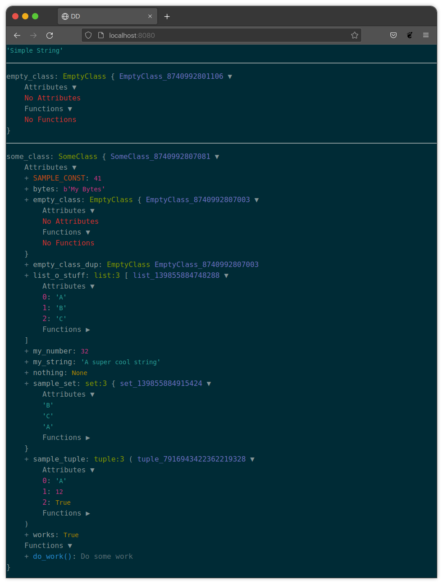

Usage
*****

General
=======
The middleware is where most of this package's heavy lifting happens.

By having the middleware installed, you can run ``dump(<variable>)`` and/or
``dd(<variable>)`` in any file that is part of the request-response cycle,
and it will run the dump logic. No importing or extra logic is required.

Each ``dump(<variable>)`` command will add the passed object to an internal
list that will be dumped either when a ``dd(<variable>)`` is used, or if the
entirety of the request finishes. You can have as many ``dump(<variable>)``
statements as you want leading up to an optional ``dd(<variable>)``.

If you make a call to ``dd(<variable>)``, execution will immediately stop
and all dumped objects (including the one sent to dd) will be output.

If you do not make a call to ``dd(<variable>)`` and only use
``dump(<variable>)`` statements, the request will continue processing until
it is time to return the response. At this point, Django-Dump-Die will
intercept and replace the response with the data that has been dumped thus
far.

To keep the page and show the dumps above its own content instead, set
:ref:`DJANGO_DD_SHOW_DUMPS_ABOVE_PAGE <show-dumps-above-page>` to ``True``.
This only works for HTML pages. Other responses, such as JSON, files, and
redirects, are still replaced by the dumps.

If the request raises an unhandled exception, the dumps from before the
exception are shown above Django's error page, so that you see both. See
:ref:`DJANGO_DD_SHOW_DUMPS_ON_ERROR_PAGE <show-dumps-on-error-page>` to turn
this off.

.. note::

    Because dump die uses middleware to internally handle keeping track of
    what to dump and then actually dumping the data to the browser, any
    call to ``dump`` or ``dd`` must be done in a file that will be processed
    during the request-response cycle. Most commonly this will be a
    ``views.py`` file, but could also be utils called from a view.
    Attempting to ``dump`` or ``dd`` from a console command will not work.

ASGI and Async Views
--------------------

On Django 3.1 or later, the middleware supports both sync and async requests.
Under ASGI it runs async, so it doesn't make Django switch between the event
loop and a thread around your views on every request. Only when something was
dumped does it render the dump page in a thread, since rendering can query the
database, such as for a dumped QuerySet. ``dump()`` and ``dd()`` work the same
in sync and async views.

Example
=======

.. code-block:: python

    # Sample classes for output.
    class EmptyClass:
        """Empty Class."""
        pass

    class SomeClass:
        """Some Class."""
        SAMPLE_CONST = 41

        def __init__(self, *args, **kwargs):
            self.my_number = 32
            self.my_string = 'A super cool string'
            self.works = True
            self.nothing = None
            self.bytes = bytes('My Bytes', 'utf-8')
            self.list_o_stuff = ['A', 'B', 'C']
            self.sample_set = {'A', 'B', 'C'}
            self.sample_tuple = ('A', 12, True)
            self.empty_class = EmptyClass()
            self.empty_class_dup = self.empty_class

        def do_work(self):
            """Do some work"""
            return True

    # Example Usage
    empty_class = EmptyClass()
    some_class = SomeClass()

    dump('Simple String')
    dump(empty_class)
    dd(some_class)

.. note::

    Most editors will give a red error squiggle for the dd command.
    This is intentional, and the command will still run. This is because this
    command is meant to be used for debugging, and is not meant to stay
    long-term. The red squiggle helps identify it as something that should be
    removed before any actual commits.

Available Parameters
====================

Both the ``dd()`` and ``dump()`` functions take the same parameters, in the
same ordering:

.. _index-range:

index_range
-----------

:Type: ``int, list, tuple``
:Default: ``None``

Which items of the dumped object to dump, if it is iterable, such as a list
or a QuerySet. Only affects the items of the dumped object itself, not of the
iterables inside it. Can be useful with large datasets, when only wanting to
examine a specific range of values. The items before and after the range are
each shown as one line with how many there are, such as ``… 18 before`` and
``… 63 more``, and a QuerySet only fetches the rows in the range.

When an index range is passed, the end index of that range overrides the
``DJANGO_DD_MAX_ITERABLE_LENGTH`` value set in settings.

Value can be:

* A single index.
* A range of two values, to specify starting and ending index (defined such as
  in a list or tuple).

Example::

    # Single index
    dump(my_list, index_range=18)  # Will do from index 18 to 18 + DJANGO_DD_MAX_ITERABLE_LENGTH
    # Range index
    dd(my_list, index_range=(18, 37))  # Will do from index 18 to 37

deepcopy
--------

:Type: ``bool``
:Default: ``None``, which uses the
          :ref:`DJANGO_DD_DEEPCOPY <deepcopy-setting>` setting (``False``
          by default)

A boolean to specify if passed objects should be deep-copied before being
passed into dd/dump logic. If set to ``True``, then preserves the exact state
of the object at the time of passing into dd/dump. Useful if you are dumping an
object, then making changes to that object, and then dumping it again.

To deep copy every dumped object, set ``DJANGO_DD_DEEPCOPY = True`` instead
of passing ``deepcopy=True`` to each call.

Example::

    # Dump starting state
    dump(my_list, deepcopy=True)
    # Update list
    my_list[5] = 42
    # Dump updated state
    dd(my_list)

Breaks Between Dumps
====================

To make a visual break between groups of dumped objects, call ``dump.br()``
between them. The break is a blank row, as tall as a one-line dump, with a line
across the middle. The ``DJANGO_DD_BREAK_STYLE`` setting picks the line's
style.

A break can also be taller. ``dump.br(size=3)`` makes one break three lines
tall, and the ``DJANGO_DD_BREAK_SIZE`` setting sets the height of breaks
without a size. The size must be a whole number of lines, 1 or more; anything
else raises a ``ValueError`` at the call.

``br()`` is a function of ``dump`` itself, so it doesn't need its own built-in
name, and like ``dump()`` it does nothing unless ``DEBUG`` is ``True``.

Example::

    dump(user)
    dump(user.profile)
    dump.br(size=2)
    dump(order)
    dump.br()
    dd(order.items)

.. _function-results:

Function Results
================

The dump can also run some functions of a dumped object, and show what they
return, in a **Function Results** section between the Attributes and the
Functions. This is off by default. Turn it on with
``DJANGO_DD_INCLUDE_FUNCTION_RESULTS``::

    DJANGO_DD_INCLUDE_FUNCTION_RESULTS = True

.. warning::

    Function results are found by **running the functions**, every time a dump
    page is shown. Before listing a function, consider that it could:

    * change something, such as saving to the database or sending an email;
    * be slow, or query the database, which adds to every dump page;
    * touch the filesystem or the network;
    * raise an error.

    Only list functions that are quick and change nothing. For your own code, a
    ``@property`` is often a better choice: properties are always shown in the
    Attributes section, marked ``@property``, and readers of your code can see
    that they are meant to be cheap.

The functions to run come from three places. All three only apply while
``DJANGO_DD_INCLUDE_FUNCTION_RESULTS`` is on.

* **A built-in list** for a few standard types:

  * ``date``: ``weekday()``
  * ``datetime``: ``weekday()``, ``timestamp()``, ``utcoffset()``, ``tzname()``
  * ``time``: ``utcoffset()``, ``tzname()``
  * ``timedelta``: ``total_seconds()``

* **A dd_function_results class attribute** on your own classes, listing the
  names of their methods to run. It is a plain tuple, so your code doesn't need
  to import anything from this package::

    class Invoice(models.Model):
        # django-dump-die: show these methods' results when an Invoice is dumped.
        dd_function_results = ("total", "is_paid")

* **The DJANGO_DD_FUNCTION_RESULTS setting**, for classes you can't change,
  by class name. A class's entry replaces the built-in list for that class, so
  an empty list turns it off. See :doc:`configuration`.

Only objects that have functions listed get a Function Results section, so
other objects look the same as with the setting off. The results are shown by
name, followed by ``()``. Some functions can't be run,
and show why in their row instead of a result:

* **Needs Arguments:** only functions that can be called without arguments are
  run.
* **An error:** if the function raises an error, it is shown in place of the
  result, and the rest of the dump is still shown. Hover over it for the
  traceback.
* **Not Found** or **Not A Function:** the listed name isn't a function of the
  object, such as after a typo.

Nothing is run for a dumped class, as opposed to an instance of one, since its
methods aren't bound to an object. Like attribute values, results are worked
out when the dump page is shown, after the view has finished, not when
``dump()`` is called.

Inside A Template
=================

There is a template tag that can also be used to dump from inside a template.
However, the use of this tag comes with a lot of caveats.

.. note::

    Only the dump tag is provided. A dd tag is not provided as template
    rendering is already occurring and trying to stop the execution of the
    rendering mid-render can be difficult.

.. warning::

    Additionally, the template tag needs to pull in the package's own JS and
    CSS. These lines are loaded in as part of the processing that the dump tag
    does. As a result, these loads are done immediately before rendering out the
    dumped data and thus may occur in the middle of the HTML document. Due to
    this, it is possible that
    `CSP rules <https://developer.mozilla.org/en-US/docs/Web/HTTP/CSP>`_ could
    prevent the required JS & CSS from properly loading.

    The package's CSS only styles the dumped output, so it doesn't change the
    rest of the page. Your site's own CSS can still affect the dumped output,
    for example through rules for every ``span`` on the page.

To use the template tag from a template you must load the template
tags via a load tag before you can use the dump tag.

.. code:: html+django

    

Once the tag library has been loaded you can dump out a variable by using the
dump tag.

.. code:: html+django

    

.. warning::

    The template tag can't dump a callable, such as a function, a class, or a
    method. Django templates call a callable variable before the tag gets it,
    so the tag dumps what the call returns, and the call runs. If the callable
    needs arguments, the tag dumps an empty string instead. For example,
    ```` dumps the user's full name, not the
    method.

    To dump a callable itself, use ``dump()`` or ``dd()`` from Python code,
    which show it without calling it.

.. note::

    There are no extra parameters that can be sent to the tag like there are
    for the Python code versions. The only parameter that can be sent is the
    object to be dumped. In general, you should be doing the majority of your
    dumping from Python code.

.. note::

    The output for this dump will not contain the name of the variable being
    dumped nor the filename and line number that the dump was called from.

.. note::

    Because the CSS for the page will be a mash-up of your project and the
    required styling for the dump, you will likely see lots of
    changes to your site when using this tag. This is normal.
